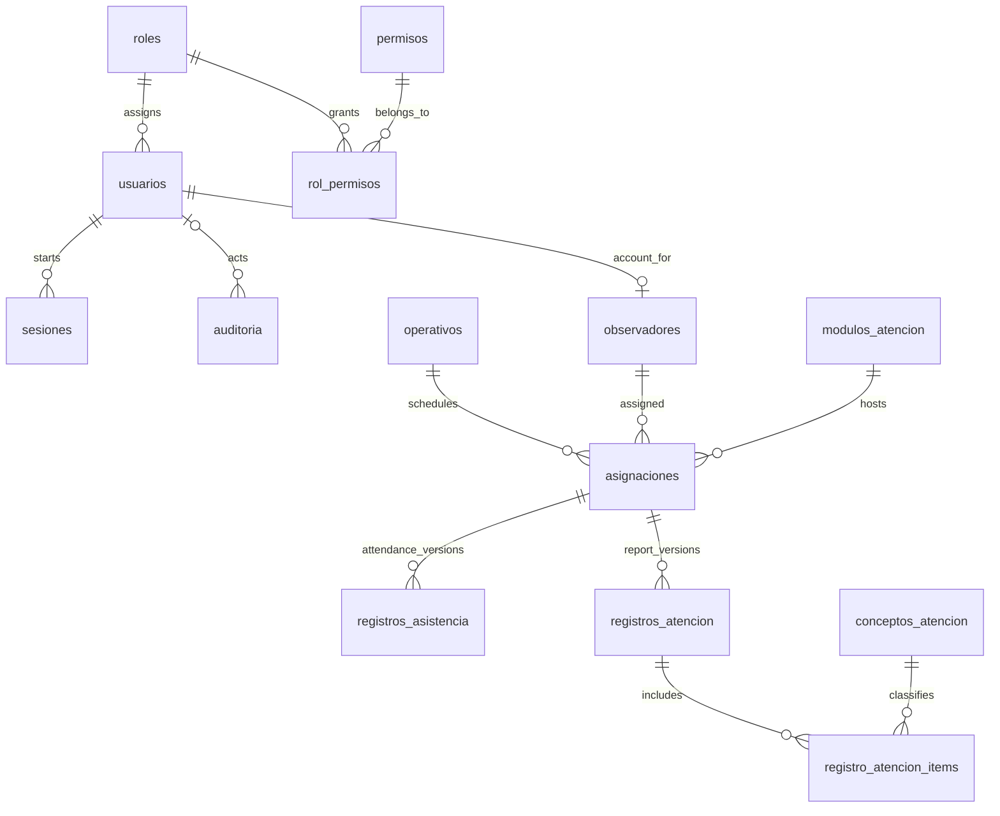

# DATABASE MODEL — Heroínas y Héroes Paisanos

> **Proposed v2 baseline for a new implementation.** This is a reviewed design proposal based on the original `DATABASE_MODEL.md` supplied on 2026-11-03. It is **not** a migration applied to the previous repository or a claim of institutional approval. Confirm the open questions before generating the initial Drizzle schema.
>
> **Scope:** Guerrero operations. **Database:** MySQL 8.4 + Drizzle ORM (versions to be selected at project setup). **API:** NestJS. **Client:** one React web application using Vite+. **Future channel:** Telegram (deferred).

## 1. Design principles

1. **Observer versus account:** `observadores` represents an operational person, while `usuarios` represents login credentials. An observer may exist without an account. An observer account has a nullable, unique 1:1 link from `observadores.usuario_id`.
2. **Assignment-centered model:** each `asignaciones` record identifies an observer, an operative, a service module, a calendar date and a same-day shift. Attendance events and attention reports belong to that assignment.
3. **Single source of business rules:** the API enforces domain rules for web, authorized manual entry and future Telegram input. `canal` records where an entry originated, not a different data model.
4. **Historical accuracy:** no physical deletion of historical operational records. Corrections of confirmed records create a new version. Revisions and significant state changes are auditable within the same transaction.
5. **No redundant aggregates:** totals are computed from detail records. Cached/denormalized aggregates are a later performance decision, not part of the initial schema.
6. **Minimum necessary personal data:** avoid CURP, home addresses, unnecessary evidence/photos and precise location records in audit payloads. Retention and privacy rules still need formal approval.
7. **Time:** schedule dates and local shift hours are civil Guerrero values; instants are stored in UTC (`DATETIME(6)`), with an explicit configured timezone for conversion.
8. **Identifiers:** UUIDv7 as `BINARY(16)` without UUID byte swapping, with strict conversion at the DB boundary. The choice is retained from the prior model, not mandated by Screaming Architecture.
9. **Controlled values:** `VARCHAR` plus SQL `CHECK` where possible. Server-side validation still required for rules involving other rows or external inputs.
10. **Explicit migrations:** never migrate automatically during API startup. Starting a fresh repository does not authorize changing the history of the old repository or any deployed database.

## 2. Scope of the initial schema

The new baseline has **14 core tables**, including version-aware operational records. The original 16-table model also contained two Telegram-only tables, which are intentionally deferred, not discarded as concepts.

| Feature | Tables | Initial scope |
|---|---|---|
| Access | `roles`, `permisos`, `rol_permisos`, `usuarios`, `sesiones` | Yes |
| Audit | `auditoria` | Yes |
| People | `observadores` | Yes |
| Operations | `operativos`, `modulos_atencion`, `asignaciones` | Yes |
| Attendance | `registros_asistencia` | Yes, version-aware |
| Attentions | `conceptos_atencion`, `registros_atencion`, `registro_atencion_items` | Yes, version-aware |
| Telegram | `vinculos_telegram`, `codigos_vinculacion` | Later, only with channel authorization |

The original document's 16 tables, initial migration `0000`, historic test results, old folder names, deployed auth state and infrastructure implementation remain **historical facts about the previous codebase**. They are not requirements for the new implementation.

## 3. Relationships

## 4. Shared conventions

All tables with a single primary key have `id BINARY(16)` (UUIDv7). Use `creado_en DATETIME(6)` on every table; add `actualizado_en DATETIME(6)` only when rows are legitimately mutable. Define timestamps in UTC at the application/connection boundary, and use an explicit UTC database session setting when needed. Primary and foreign keys use `RESTRICT` by default; **do not configure cascades that would erase audit or operational history**. Foreign keys to nullable actors retain history if an account is deactivated (not deleted).

For `DATE` and `TIME` fields, expose strict calendar strings (`YYYY-MM-DD`) and local-clock strings (`HH:mm:ss`) at the application boundary. Do not parse shift dates as UTC instants.

## 5. Identity, access and audit

### `roles`
`id`; `codigo VARCHAR(50) UNIQUE`; `nombre VARCHAR(100)`; `descripcion VARCHAR(355) NULL`; `activo BOOLEAN`.

### `permisos`
`id`; `codigo VARCHAR(100) UNIQUE` (`resource:action`); `descripcion VARCHAR(500) NULL`.

### `rol_permisos`
Composite primary key (`rol_id`, `permiso_id`) plus `creado_en`. Both columns are FKs.

### `usuarios`
`id`; `rol_id FK`; `nombre_usuario VARCHAR(50) UNIQUE`; `nombre_completo VARCHAR(150)`; `password_hash VARCHAR(255)`; `activo BOOLEAN`; `debe_cambiar_password BOOLEAN`; `password_cambiada_en DATETIME(6) NULL`; `intentos_fallidos SMALLINT`; `bloqueado_hasta DATETIME(6) NULL`; `ultimo_acceso_en DATETIME(6) NULL`; timestamps. Index (`rol_id`, `activo`).

A user has one role in the existing design. Do not introduce office/territory scopes unless the functional requirements require them. Enforce active-user and last-active-admin protections in transactions. An observer account is associated with at most one observer profile.

### `sesiones`
`id`; `usuario_id FK`; `token_hash CHAR(64) UNIQUE`; `ultima_actividad_en DATETIME(6)`; `expira_por_inactividad_en DATETIME(6) NULL`; `expira_en_absoluto DATETIME(6)`; `revocada_en DATETIME(6) NULL`; `revocada_por FK usuarios NULL`; `motivo_revocacion VARCHAR(255) NULL`; `ip VARCHAR(45) NULL`; `user_agent VARCHAR(500) NULL`; `creado_en`.

Keep opaque server-side sessions with an `httpOnly` cookie and hashed random token. Argon2id remains the password hashing choice. The prior 30-minute idle/10-hour absolute (ADMIN/ENLACE), seven-day absolute (OBS) and five-failures/15-minute lockout are **prior decisions to confirm** when consolidating security requirements, not database defaults.

### `auditoria`
`id`; `usuario_id FK NULL`; `sesion_id FK NULL`; `accion VARCHAR(100)`; `tipo_entidad VARCHAR(100)`; `entidad_id BINARY(16) NULL`; `valores_anteriores JSON NULL`; `valores_nuevos JSON NULL`; `motivo VARCHAR(500) NULL`; `canal VARCHAR(20) NULL`; `ip VARCHAR(45) NULL`; `user_agent VARCHAR(500) NULL`; `creado_en`. Index (`tipo_entidad`, `entidad_id`) and (`usuario_id`, `creado_en`).

Use an explicit allowlist for auditable fields. **Never log passwords, hashes, tokens, one-time codes, precise coordinates or unfiltered row snapshots.** Append-only must be enforced by application permissions and database account design; simply naming this table `auditoria` does not make it immutable.

## 6. People and scheduling

### `observadores`
`id`; `nombres VARCHAR(100)`; `apellidos VARCHAR(100)`; `telefono VARCHAR(20) NULL`; `usuario_id FK usuarios NULL UNIQUE`; `activo BOOLEAN`; timestamps.

A person can participate in an operative without credentials, for authorized manual entry. Accounts are linked explicitly. The prior no-reassignment rule should be confirmed in requirements before it becomes permanent.

### `operativos`
`id`; `nombre VARCHAR(120)`; `fecha_inicio DATE`; `fecha_fin DATE`; `estado VARCHAR(20)` (`borrador`, `activo`, `cerrado`); `tolerancia_minutos SMALLINT UNSIGNED NULL`; `precision_maxima_m SMALLINT UNSIGNED NULL`; timestamps. Check `fecha_inicio <= fecha_fin`.

Tolerance and GPS precision settings are nullable: no invented automatic validation policy. Operational defaults and location requirements need confirmation.

### `modulos_atencion`
`id`; `nombre VARCHAR(120)`; `municipio VARCHAR(100)`; `latitud DECIMAL(9,6) NULL`; `longitud DECIMAL(9,6) NULL`; `radio_validacion_m SMALLINT UNSIGNED NULL`; `activo BOOLEAN`; timestamps.

Check coordinate ranges and require both coordinates present or both absent. GPS/geo-fence columns are **optional preparedness**, not authorization to collect coordinates.

### `asignaciones`
`id`; `operativo_id FK`; `observador_id FK`; `modulo_id FK`; `fecha DATE`; `hora_inicio TIME`; `hora_fin TIME`; `cancelada_en DATETIME(6) NULL`; `creado_por FK usuarios`; timestamps.

- Same-day shifts only; `hora_fin > hora_inicio`.
- Dates must fall within the operative window.
- One observer may have multiple same-day assignments without overlapping shifts. Validate overlapping intervals transactionally; unique indexes alone do not enforce arbitrary interval overlaps.
- Keep cancelled assignments for history. Use the existing nullable generated-current marker approach or a verified equivalent to block exact duplicates of active assignments.
- Reject a cancellation that would invalidate existing attendance/attention records, unless a separately authorized correction workflow explicitly handles it.

## 7. Attendance with correction history

### `registros_asistencia`
`id`; `asignacion_id FK`; `tipo VARCHAR(10)` (`entrada`, `salida`); `version INT UNSIGNED` (starts at 1); `vigente BOOLEAN NULL` (`1` for current, `NULL` for superseded); `registrado_en DATETIME(6)`; `latitud DECIMAL(9,6) NULL`; `longitud DECIMAL(9,6) NULL`; `precision_m DECIMAL(10,3) NULL`; `canal VARCHAR(20)` (`manual`, `web`, future `telegram`); `registrado_por FK usuarios`; `motivo_captura_manual VARCHAR(500) NULL`; `estado VARCHAR(20)` (`verificada`, `por_revisar`, `aceptada`, `rechazada`); `alertas JSON`; `revisado_por FK usuarios NULL`; `revisado_en DATETIME(6) NULL`; `observaciones VARCHAR(500) NULL`; `motivo_correccion VARCHAR(500) NULL`; timestamps.

Indexes/constraints:
- Unique (`asignacion_id`, `tipo`, `version`).
- Unique (`asignacion_id`, `tipo`, `vigente`) where historical rows have `vigente = NULL` and the current row has `vigente = 1`.
- `CHECK (vigente IS NULL OR vigente = 1)`; version positive; coordinates valid and paired; precision nonnegative.
- A new corrected mark is inserted at a higher version while the previous version becomes non-current, in one transaction with audit; do not modify original marked time in place.
- A duplicate initial `entrada`/`salida` is rejected rather than silently creating version 2. Versions are created only through an authorized correction procedure.
- A rejected mark remains as evidence; whether it can be replaced or annulled requires an explicit functional policy.

**Important distinction:** `registrado_en` is when the attendance occurred (server receipt for remote capture; reported time for an authorized late manual entry), while `creado_en` is when this version was stored. Use a separate recorded timestamp only if the actual channel requires a different event time.

**Status semantics retained pending confirmation:** `verificada` represents automatic rule-based verification, `por_revisar` pending human review, `aceptada` human acceptance, and `rechazada` human rejection. The original policy states manual entries are initially accepted and observer entries require review; ensure the exact transition table is confirmed before implementation.

## 8. Attention reports with correction history

### `conceptos_atencion`
`id`; `clave VARCHAR(40) UNIQUE`; `nombre VARCHAR(150)`; `orden SMALLINT`; `requiere_especificacion BOOLEAN`; `activo BOOLEAN`; timestamps.

This is a global catalog unless requirements specify otherwise. Do not invent official concept names. Preserve historical meaning: deactivate, rather than rename/reinterpret, referenced concepts.

### `registros_atencion`
`id`; `asignacion_id FK`; `version INT UNSIGNED` (starts at 1); `vigente BOOLEAN NULL` (`1` current, `NULL` superseded); `canal VARCHAR(20)`; `registrado_por FK usuarios`; `estado VARCHAR(20)` (`borrador`, `enviado`, `validado`, `observado`); `revisado_por FK usuarios NULL`; `revisado_en DATETIME(6) NULL`; `observaciones VARCHAR(500) NULL`; `motivo_correccion VARCHAR(500) NULL`; timestamps.

Indexes/constraints:
- Unique (`asignacion_id`, `version`).
- Unique (`asignacion_id`, `vigente`) with historical `NULL` and current `1`.
- Validated or observed reports require a reviewer and review time; all required transitions are enforced in the API transaction.
- An editable draft is the **current version** until submitted. Corrections after confirmation create a new report version with a new set of items rather than overwriting the validated history.
- Only one current logical report exists per assignment, even if there are several historical versions.

### `registro_atencion_items`
Composite primary key (`registro_atencion_id`, `concepto_id`); `cantidad INT UNSIGNED`; `especificacion VARCHAR(500) NULL`; timestamps. Both columns of the key are foreign keys.

Every report version has its own immutable-on-confirmation set of items. Zero counts are permitted. For a concept requiring specification (e.g., `Otro`), a positive quantity requires **one general description for its total**, as in the original approved model.

**Draft policy to confirm:** whether a draft is optional, how many drafts per assignment are allowed (this model permits one current report), and the point after which editing requires a new version.

## 9. Derived values

- Attendance completeness per assignment (missing, entrance only, entrance and exit, reviewed exceptions).
- Tardiness, calculated against shift start and operative tolerance, not stored redundantly.
- Attention totals by concept, date, shift, module, observer or operative; query only the current, applicable versions.
- Effective session validity based on revocation and expiration.
- Report exports generated from applicable current records; snapshots can be added later if an institutional retention rule requires them.

## 10. Future Telegram extension (not in initial migration)

If the channel is authorized, add:

- `vinculos_telegram`: observer identity, signed-safe Telegram user/chat identifiers, link time, revoke time, linked/revoking actor, uniqueness of active links, and history.
- `codigos_vinculacion`: observer, one-time code hash, expiry, consumption/revocation and issuing actor.

Never authenticate a request solely from a Telegram username or client-supplied user ID. Authorize service-to-API calls, validate active bindings and reuse the same business rules. The future extension will require its own reviewed migration.

## 11. Security and operations

- Authorization uses role, permissions and resource ownership. Earlier ADMIN/ENLACE `GLOBAL` and OBSERVADOR `OWN` semantics apply only to the Guerrero scope; do not infer national access.
- Mutations affecting operational state and audit records must be committed atomically.
- Protect against duplicate submissions and concurrent updates by transactional locking, unique constraints and appropriate API-level idempotency decisions.
- Use real backup, retention and migration policies before production. No deletion/purge policy is inferred from this schema.
- Do not collect or export actual observer information through unapproved external services while developing this system.

## 12. Decisions requiring confirmation before schema generation

1. **Attendance review transitions:** precise meaning of automated verification, human acceptance/rejection, and whether rejected records can be corrected.
2. **Report lifecycle:** draft creation, editing, submission, validation, observation, correction and annulment; whether a new version is allowed only after verification or also after an observed report.
3. **Location requirements:** whether coordinates and accuracy should be stored from the start or postponed until the collection channel and authorization are defined.
4. **Retention:** retention periods for accounts, sessions, audit, precise location data and report history.
5. **Security timeouts:** preserve or revise the previous role-specific session/lockout parameters.
6. **Assignment corrections:** permitted cancellation behavior once capture exists and whether replacement assignments require linking.
7. **Access permissions:** validate the previous catalog against the new unified web app and actual operational roles without silently importing its old implementation status.

## 13. Implementation notes for the new repository

Use Screaming Architecture for modules; do not reproduce the old `apps/backend/src/infrastructure/database/schema/` layout solely out of habit. Put database initialization/migrations in a small dedicated database area, and organize business repositories according to the modules they serve. Do not create empty architectural layers. Let Drizzle generate an initial migration from the **approved** baseline; do not copy the previous project's applied `0000` unchanged and then force new requirements into corrective migrations.

**Not included here:** endpoint catalog, authorization matrix, official concepts, form-specific requirements, deployment topology and UI design. Consolidate those in functional requirements and task-specific documents before implementation.
